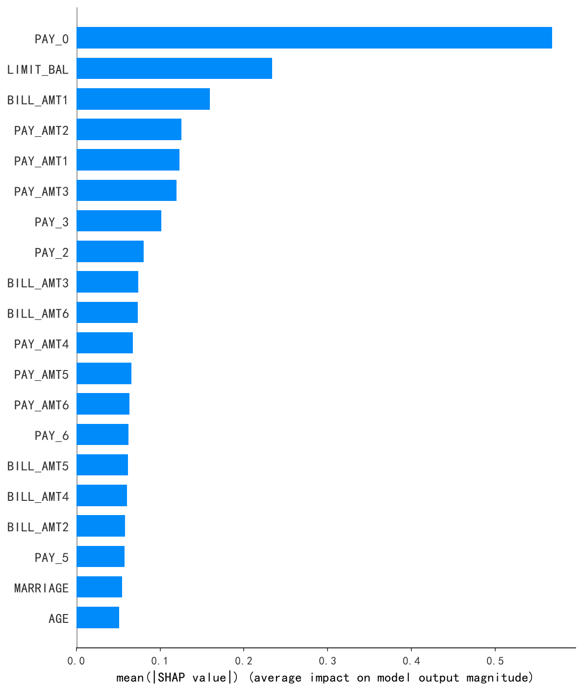
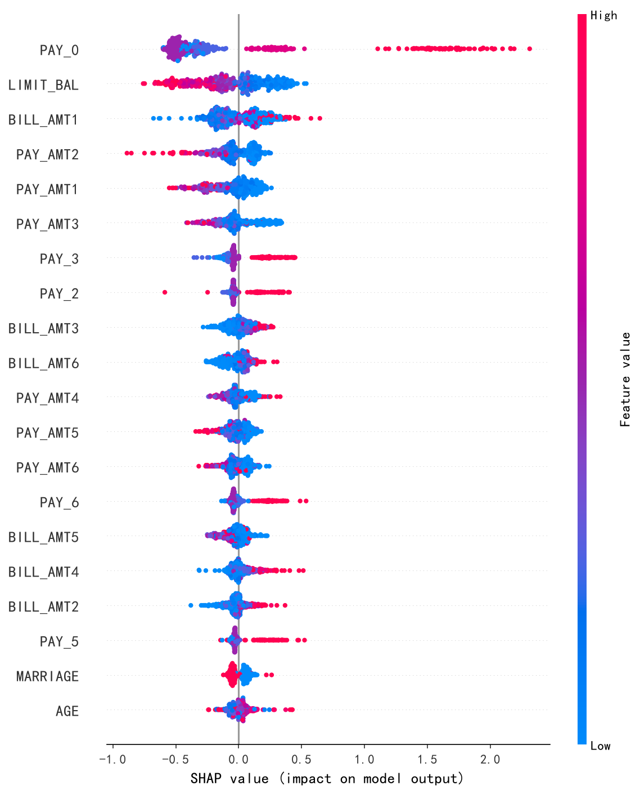
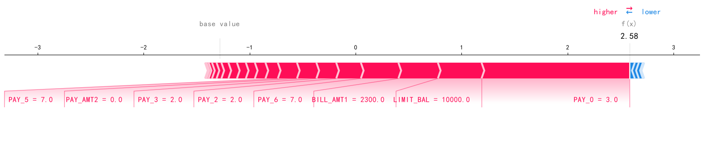
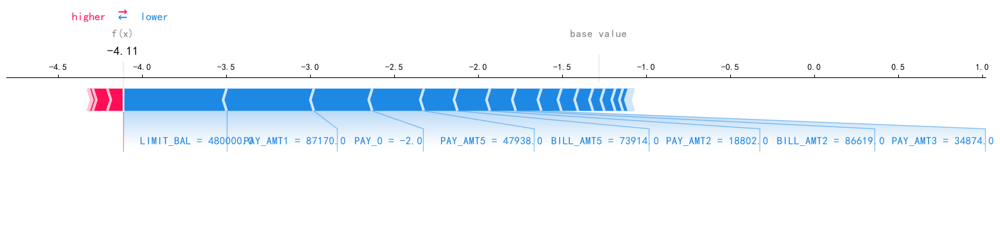

# 基于SHAP可解释性的信用违约预测研究

基于UCI台湾信用卡违约数据集（30000条记录，23个特征），使用XGBoost构建信用违约预测模型，并利用SHAP方法进行全局与局部可解释性分析。

## 项目背景

信用违约预测是银行风控的核心问题。传统评分卡模型可解释性强但预测能力有限，机器学习模型预测能力强但"黑箱"特性难以被监管接受。本项目旨在用SHAP方法在两者之间找到平衡——既保留XGBoost的预测能力，又提供满足监管要求的可解释性。

## 数据集

| 项目 | 内容 |
|------|------|
| 来源 | UCI Machine Learning Repository |
| 规模 | 30000条，23个特征 |
| 目标变量 | default payment next month（0=不违约，1=违约） |
| 违约率 | 22.12%（类别不平衡） |

## 方法

- **模型**：XGBoost（n_estimators=200, max_depth=4, learning_rate=0.1, subsample=0.8）
- **解释方法**：SHAP（全局解释 + 局部解释）

## 模型性能

| 指标 | 数值 |
|------|------|
| 准确率 | 81.72% |
| AUC | 0.776 |
| 违约类别F1 | 0.47 |

## SHAP全局解释

特征重要性前三：PAY_0、LIMIT_BAL、BILL_AMT1

- **PAY_0**：最近一个月还款状态，延迟还款大幅推高违约概率
- **LIMIT_BAL**：信用额度，低额度推高违约概率，高额度降低违约概率

## SHAP局部解释：高低风险客户对比

| 维度 | 高风险客户 | 低风险客户 |
|------|-----------|-----------|
| 信用额度 | 1万（极低） | 48万（极高） |
| 还款记录 | 6个月零还款 | 8.7万、4.8万大额还款 |
| PAY_0 | 3（延迟3个月） | -2（无消费） |
| 预测值 f(x) | +2.58（违约） | -4.11（不违约） |

两个客户的预测值差距高达6.69，SHAP力导向图清晰展示了信用额度和还款行为是决定违约预测的两个核心维度。

## 结论

XGBoost模型在信用违约预测上表现良好（准确率81.72%，AUC 0.776）。SHAP分析表明：PAY_0和LIMIT_BAL是最核心的预测特征，延迟还款推高违约概率，低信用额度推高违约概率。SHAP方法在保持模型预测能力的同时，提供了满足监管要求的可解释性。

## 技术栈

- Python（Pandas、Scikit-learn、XGBoost、SHAP、Matplotlib）
- Jupyter Notebook

## 项目文件

| 文件 | 说明 |
|------|------|
| `credit_default_shap.ipynb` | 完整分析代码 |
| `shap_global_importance.png` | SHAP全局重要性 |
| `shap_summary.png` | SHAP蜂群图 |
| `shap_force_high_risk.png` | 高风险客户力导向图 |
| `shap_force_low_risk.png` | 低风险客户力导向图 |
| `roc_curve.png` | ROC曲线 |
